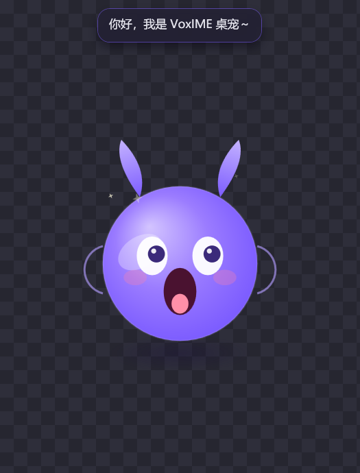
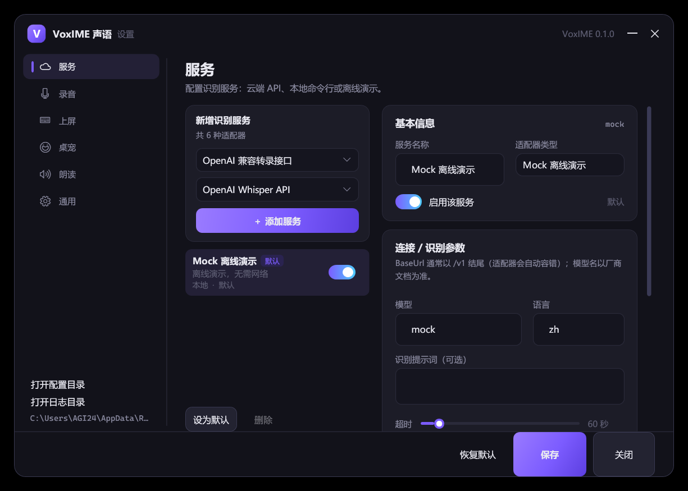
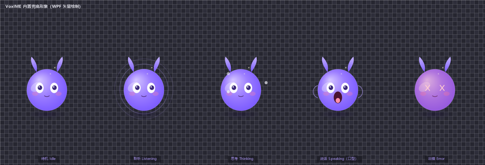
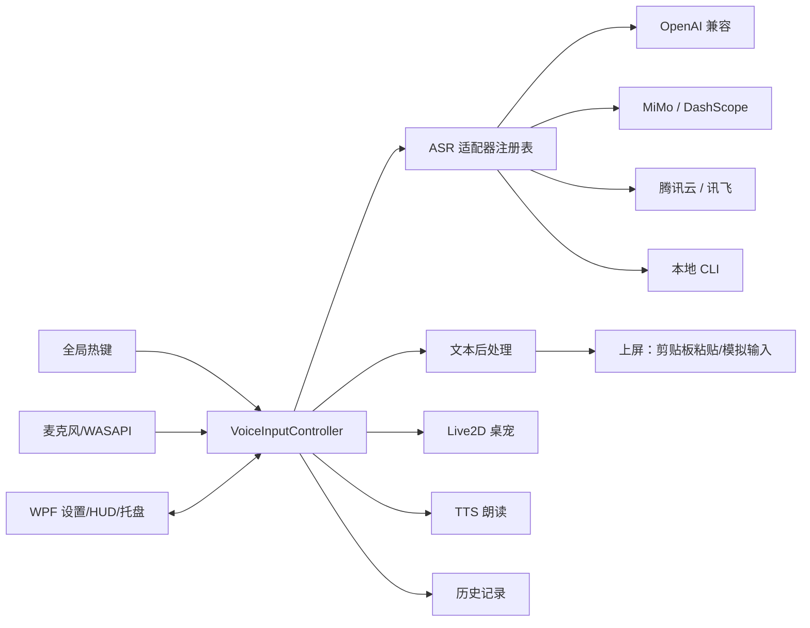

# VoxIME 声语 · Windows 桌面语音输入法

[](https://github.com/Janzhynhuh/VoxIME/actions/workflows/ci.yml)
[](https://github.com/Janzhynhuh/VoxIME/releases/latest)
[](LICENSE)
[](https://dotnet.microsoft.com/)

> 按住一个键说话，文字自动出现在任何输入框里；桌面上还有一个可自定义的 Live2D 形象在听你说话。
> 多厂商语音识别可插拔：OpenAI 兼容接口、小米 MiMo、阿里云 DashScope、腾讯云、科大讯飞、本地 whisper.cpp / FunASR / sherpa-onnx……

仓库：<https://github.com/Janzhynhuh/VoxIME>（MIT，欢迎 Star / Issue / PR）

- 平台：Windows 10/11 x64（.NET 10）
- 形态：悬浮语音助手 + 全局热键 + 透明置顶桌宠（Live2D 模型 / 内置矢量兜底形象）



| 设置中心（服务页） | 桌面上的透明桌宠（内置兜底形象） | 内置兜底形象的五种状态 |
|---|---|---|
|  |  |  |

> 截图均由本仓库代码在 Windows 11 真机运行产生；真实厂商联调记录（小米 MiMo，识别结果与合成语音原文逐字一致）见 [docs/verification/e2e-mimo-real-asr.json](docs/verification/e2e-mimo-real-asr.json)，更多材料见 [docs/screenshots](docs/screenshots) 与 [docs/verification](docs/verification)。

---

## ✨ 功能特性

| 模块 | 能力 |
|---|---|
| 语音输入 | 按住 `Ctrl+Alt` 说话（松开即识别），或按 `Ctrl+Alt+M` 开始/结束；支持把热键改成鼠标侧键（`MouseX1`/`MouseX2`/`MouseMiddle`），每个功能可配置多个热键；识别结果自动粘贴到当前焦点窗口 |
| 多厂商 ASR | 一套配置界面接入 OpenAI Whisper / 硅基流动 / LM Studio 等兼容接口、小米 MiMo-ASR、阿里 DashScope、腾讯云、讯飞、本地 CLI 离线识别，随时切换 |
| 本地离线 | 支持 whisper.cpp、FunASR、sherpa-onnx 命令行，无需联网与 API Key |
| 编辑与历史 | HUD 显示识别结果，可先预览编辑再上屏；完整历史记录、可复制、可清空 |
| 朗读 | Windows SAPI TTS 朗读识别结果（可选），语速/音色可配 |
| Live2D 桌宠 | 透明置顶窗口，加载 Cubism 3/4/5 模型（含 MOC3 v5）；待机动画、眨眼、眼动跟随鼠标、聆听/思考/朗读/出错状态联动、麦克风或 TTS 驱动口型、气泡字幕；无模型时内置矢量兜底形象 |
| 托盘与设置 | 托盘菜单、开机自启、暂停热键、设备选择、VAD 静音自动停止、术语替换、深色主题设置中心 |
| 隐私安全 | 配置/历史/日志在本机；API Key DPAPI 加密落盘；日志不打印密钥 |

## 🚀 快速开始

### 方式一：使用发布包（推荐）

1. 从 [GitHub Releases](https://github.com/Janzhynhuh/VoxIME/releases/latest) 下载 `VoxIME-win-x64-v0.3.0.zip`，解压到任意目录（不要放在 C:\Program Files 下，避免写入权限问题）。
2. 双击 `VoxIME.exe` 启动，托盘出现声语图标。
3. 托盘右键 → **设置**：
   - 「服务」页点击 **新增服务**，选择你的识别厂商，填入 BaseUrl / Model / API Key，点 **测试识别** 验证。
   - 或选择 **本地离线（命令行）**，填入本机 `whisper-cli.exe` 等路径。
4. 回到任意输入框，按住 `Ctrl+Alt` 说话，松开后文字自动上屏。
5. 桌宠默认出现在屏幕右下角；`设置 → 桌宠` 可换模型、调大小/透明度/点击穿透。

### 方式二：源码构建

```powershell
# 要求：Windows 10/11 x64 + .NET 10 SDK
git clone https://github.com/Janzhynhuh/VoxIME.git VoxIME && cd VoxIME
dotnet build VoxIME.sln -c Release
dotnet run --project src/VoxIME.App

# 发布自包含 x64 包（含 .NET 运行时，目标机器无需安装 SDK）
.\scripts\publish-x64.ps1
# 产物：deploy\VoxIME-win-x64\ 与 deploy\VoxIME-win-x64-v0.3.0.zip
```

## 🎙️ 支持的语音识别服务

| 厂商 / 协议 | 适配器 | BaseUrl 示例 | 默认模型 | 备注 |
|---|---|---|---|---|
| OpenAI Whisper API | OpenAI 兼容 | `https://api.openai.com/v1` | `whisper-1` | 官方文件识别接口 |
| 硅基流动 SiliconFlow | OpenAI 兼容 | `https://api.siliconflow.cn/v1` | `FunAudioLLM/SenseVoiceSmall` | 国内访问快，中文效果好 |
| LM Studio / 本地 OpenAI 服务 | OpenAI 兼容 | `http://127.0.0.1:1234/v1` | `whisper-1` | 本地无 Key，可离线 |
| 任意 OpenAI 兼容端点 | OpenAI 兼容 | 自定义 | 自定义 | 只要实现 `/audio/transcriptions` |
| 小米 MiMo ASR | OpenAI Chat Audio | `https://api.xiaomimimo.com/v1` | `mimo-v2.5-asr` | `input_audio` + `asr_options.language` |
| 阿里云 DashScope | OpenAI Chat Audio | `https://dashscope.aliyuncs.com/compatible-mode/v1` | `qwen3-asr-flash` | 也可用 Paraformer 实时接口（后续版本） |
| 腾讯云一句话识别 | 腾讯云 TC3 签名 | `asr.tencentcloudapi.com` | `16k_zh` | 需 SecretId / SecretKey |
| 科大讯飞实时听写 | WebSocket IAT | `wss://iat-api.xfyun.cn/v2/iat` | `16k_zh` | 需 AppId / ApiKey / ApiSecret |
| whisper.cpp | 本地 CLI | - | `ggml-*.bin` | 完全离线，推荐 `whisper-cli.exe` |
| FunASR | 本地 CLI | - | `paraformer-zh` | 完全离线 |
| sherpa-onnx | 本地 CLI | - | `sense-voice` | 完全离线 |
| Mock | 内置 | - | - | 演示/自检用，不需要网络和麦克风 Key |

> 各厂商的详细字段、示例配置与费用/限额提示见 [docs/providers.md](docs/providers.md)。
> 厂商接口可能调整，若报错请先对照官方文档核对 BaseUrl/模型名。

## 🎮 使用说明

- **按住说话**：按住 `Ctrl+Alt`（可改），松手后识别并上屏；`Esc` 取消。
- **切换模式**：`Ctrl+Alt+M` 开始/结束（可在设置中改成默认模式；选择该模式会自动启用切换热键，避免“模式选对了但热键未启用”）。
- **鼠标侧键**：设置 → 录音 → 把光标放进热键输入框后按鼠标侧键/中键，即可录成 `MouseX1` / `MouseX2` / `MouseMiddle`（也支持 `Ctrl+MouseX1` 等组合）。每个功能可以点「+ 添加一个热键」配置多个热键，任意一个触发即可；鼠标侧键命中已配置热键时 VoxIME 会拦截该键，避免同时触发浏览器前进/后退。
- **HUD**：屏幕底部状态条显示聆听/识别状态；开启「预览确认」时可先编辑再按回车插入。
- **托盘菜单**：显示/隐藏桌宠、暂停热键、设置、历史记录、打开日志目录、退出。
- **桌宠**：右键托盘可显示/隐藏；`设置 → 桌宠` 可设置点击穿透、置顶、缩放、口型灵敏度、**眼动采样帧率（5–300 FPS，默认 30；实际画面刷新受显示器刷新率限制）**与各状态表情映射。
- 对**以管理员身份运行**的程序，普通权限的 VoxIME 无法模拟按键/粘贴（Windows UIPI 限制）；此时请右键以管理员身份运行 VoxIME，识别结果仍会复制到剪贴板。

## 🧩 Live2D 模型

- 支持 Live2D **Cubism 3 / Cubism 4** 模型（`.model3.json`，需包含 `.moc3`、贴图、动作/物理文件）。
- **模型管理**：设置 → 桌宠 → 「选择模型」下拉框可切换已导入模型或「内置兜底形象」；用「导入文件夹…」/「导入 ZIP…」把模型复制到模型库（默认 `%APPDATA%\VoxIME\models`，原文件夹保留；重名自动加序号；点「修改位置…」可换到其它磁盘；可打开模型库目录或删除副本）。默认会保持窗口高度，把宽度收紧到模型显示宽度左右各留约 5px padding（可在设置里关闭，缩放变化时也会重算；开启时宽度滑块自动置灰）；缩放/裁剪后可用「模型水平偏移 / 垂直偏移」把模型移到窗口内想要的位置。窗口底部自动吸附可关闭：拖到**所在屏幕**底部约 100px 内会贴底，只改上下、不动左右，向上拖不会被拉回；还可让窗口底部保持在任务栏之上。桌宠设置页提供「重置位置」，可清除上次拖动位置并让桌宠回到默认位置；显示器分辨率/布局变化或旧坐标落到屏幕外时，启动/检测到变化会自动把桌宠移回当前屏幕可见位置。状态表情映射改为下拉选择：自动扫描 `model3.json` 的 `Expressions` 以及 VTube Studio 常见的 `Exp3/*.exp3.json`，`Animation/*.motion3.json` 也会注册为动作资源；映射按模型分别记忆。
- **眼动上下反转**：个别模型上下方向相反时，在 设置 → 桌宠 → 动作与口型 勾选「眼动上下反转」，会按模型记住（只影响 Live2D 模型，内置兜底形象不受影响）。
- 没有模型也能用：内置矢量兜底形象（呼吸、眨眼、口型、聆听波纹、思考/出错动画），可在下拉框中随时选回。
- 官方示例模型（Hiyori / Haru 等）可从 Live2D 官方 CubismWebSamples 获取：
  ```powershell
  .\scripts\fetch-sample-model.ps1   # 下载 Hiyori 到 assets\live2d\models\Hiyori
  ```
- **许可提醒**：Live2D Cubism Core 与官方示例模型有独立使用条款，商业分发前请阅读 [Live2D SDK 许可](https://www.live2d.com/sdk/license/) 并自行取得授权。详见 [docs/live2d.md](docs/live2d.md)。

## 🔐 数据与隐私

| 内容 | 位置 |
|---|---|
| 配置（含 DPAPI 加密后的 Key） | `%APPDATA%\VoxIME\config.json` |
| 历史记录（JSONL） | `%APPDATA%\VoxIME\history.jsonl` |
| 日志 | `%APPDATA%\VoxIME\logs\` |
| 录音临时文件 | `%APPDATA%\VoxIME\audio\`（识别后可清理） |
| WebView2 用户数据 | `%APPDATA%\VoxIME\webview2\`（Live2D 页面缓存，可安全删除） |

- API Key 仅在内存中明文，落盘前用当前 Windows 用户 DPAPI 加密（`ProtectedData`）。
- 音频只发送给你选择的识别服务；本地 CLI 模式完全不出本机。
- 程序不包含任何遥测/统计上报。

## 🏗️ 架构一览



- `VoxIME.Core`：音频采集、热键、文本上屏、TTS、ASR 适配器、配置、历史、主控制器（无 UI 依赖）。
- `VoxIME.Live2D`：透明置顶窗口、WebView2 宿主、JS 桥、WPF 兜底形象。
- `VoxIME.App`：WPF 外壳（托盘 / HUD / 设置 / 历史 / 首次引导）与服务装配。
- 详细设计见 [docs/ARCHITECTURE.md](docs/ARCHITECTURE.md)，产品定义见 [docs/PRODUCT.md](docs/PRODUCT.md)。

## 👩‍💻 开发

```powershell
dotnet build VoxIME.sln          # 全量构建（0 warning / 0 error）
dotnet test                       # 338 个离线单元测试
.\scripts\publish-x64.ps1         # 发布 x64 自包含包
.\scripts\run.ps1                 # 开发模式运行
.\scripts\e2e-smoke.ps1           # 端到端自检：录音→Mock 识别→上屏到前台文本框，结果写 %TEMP%\voxime-e2e-result.json
```

应用内置两个隐藏自检入口（开发/CI 用，不影响正常用户）：

- `VoxIME.exe --tray --selftest`：依次构造并显示全部窗口后退出，日志写 `SELFTEST` 行，退出码 0/2。
- `VoxIME.exe --tray --e2e`：等待 `VOXIME_E2E_DELAY_SECONDS` 秒后录音 3 秒，走完整识别/上屏链路并写结果 JSON；无麦克风语音时用合成音频验证识别+上屏。

> **提交规范（强制）**：每次改动必须单独 commit，且提交前 Release 构建 + 全量测试必须通过。
> 详见 [CONTRIBUTING.md](CONTRIBUTING.md) 与 [AGENTS.md](AGENTS.md)；GitHub Actions（[.github/workflows/ci.yml](.github/workflows/ci.yml)）会执行同样的构建、测试与发布产物构建。

目录结构：

```
src/
  VoxIME.Core/      # 核心逻辑（net10.0-windows）：Abstractions / Audio / Asr / Configuration / Hotkeys / TextInsertion / Tts / Services / History / Logging
  VoxIME.Live2D/    # Live2D 桌宠（WPF + WebView2）
  VoxIME.App/       # WPF 应用外壳（托盘/HUD/设置/历史）
tests/
  VoxIME.Core.Tests # xUnit 单元测试
assets/             # 图标、Live2D 网页资源
docs/               # 架构/产品/厂商/Live2D 文档
scripts/            # 构建、发布、示例模型下载
```

**接入新的语音厂商**（约 100 行）：实现 `IAsrProvider`（一个 `TranscribeAsync`），在 `AsrProviderRegistry` 注册类型 ID 与 `AsrProviderPreset`，即可在设置页出现。详见 [docs/ARCHITECTURE.md](docs/ARCHITECTURE.md#扩展新的语音识别厂商)。

## ❓ FAQ

**Q：为什么按住热键没反应？**
A：检查设置里的热键是否被其他软件占用（如输入法、游戏宏）；尝试换成 `F2`/`Ctrl+Shift+Space`。托盘菜单的「暂停热键」若开启也会导致无响应。

**Q：识别结果没有出现在输入框？**
A：目标程序以管理员身份运行时，受 Windows UIPI 限制无法模拟输入；请以管理员身份运行 VoxIME，或使用 HUD 上的「复制」按钮。部分全屏独占游戏也不支持模拟输入。

**Q：按住说话提示“没有检测到语音”？**
A：新版会在状态栏/日志里显示「输入峰值 X% / 检测阈值 Y%」，设置 → 录音 →「测试麦克风（3 秒）」也会显示本次最大电平和实际设备名；测试时会关闭录音提示音，避免虚拟设备把提示音回录造成“有电平”的假阳性。峰值接近 0% 时检查 Windows 麦克风权限/设备（默认设备可能被 UU 远程等虚拟麦克风占用，可在设置里手动选真实麦克风）；峰值有波动但仍提示无语音时，把「语音检测阈值」调低（默认 0.003，可降到 0.001）。

**Q：用着用着鼠标突然点不了屏幕 / 卡住？**
A：旧版本把开始/结束录音等逻辑直接跑在全局鼠标钩子线程里，钩子被阻塞时整机鼠标都会卡；最新版已改为「钩子只入队 + 独立后台线程处理」，并让 HUD 预览模式的透明边距也鼠标穿透。若仍遇到，可在托盘菜单「暂停热键」或退出重开。

**Q：识别报 401 Unauthorized / Invalid API Key？**
A：说明本地没有可用的 API Key（或被平台撤销），不是环境变量问题。到 设置 → 服务 → 对应服务重新粘贴 API Key → 保存 → 点「测试识别」；Key 会用 Windows DPAPI 加密保存在本地。旧版本保存其它设置时可能把 Key 清空，最新版已修复（服务页 PasswordBox 直接写回配置，且保存时会保留已加密凭据）。

**Q：桌宠模型看起来分辨率低 / 缩放没变化？**
A：桌宠窗口是固定像素区域，**窗口宽度/高度越大越清晰**；「模型缩放」已在最新版修复为在窗口内真实缩放，并随缩放提高渲染分辨率（>1 会放大并裁剪超出窗口的部分，想显示更大请同时调大窗口尺寸）。旧版的缩放走 WebView2 页面缩放，会被页面重新适配掉，表现为几乎不变或发糊。

**Q：桌宠不显示 / 黑块？**
A：确认系统已安装 WebView2 Runtime（Win11 自带，精简系统可能缺失）；缺失时程序会自动降级为内置矢量形象。若指定模型损坏，请换回默认或删除设置中的模型目录。

**Q：本地离线识别怎么配？**
A：安装 whisper.cpp（`whisper-cli.exe`）并下载 `ggml-*.bin` 模型；设置 → 服务 → 新增「本地离线（命令行）」，填写可执行文件路径与参数模板：`-m D:\models\ggml-small.bin -f {wav} -l {lang} -otxt -of {out}`，输出模式选 `file`。

## 🗺️ Roadmap

- [x] v0.1：悬浮语音助手、多厂商 ASR、Live2D 桌宠、WPF 设置、x64 发布
- [ ] v0.2：流式识别（边说边出字）、ASR 失败自动降级多服务、词典/热词
- [ ] v0.3：TSF 输入法框架注册（语言栏可见）、UWP/管理员窗口增强注入
- [ ] v0.4：云 TTS + 口型 viseme、多语言 UI、插件市场（厂商适配器 DLL）

## 📄 许可与致谢

本项目代码以 MIT 许可发布（见 `LICENSE`）。第三方组件与素材许可见 [THIRD-PARTY-NOTICES.md](THIRD-PARTY-NOTICES.md)。

致谢：NAudio、Microsoft WebView2、PixiJS、untitled-pixi-live2d-engine、Live2D Cubism SDK，以及所有语音识别服务厂商。

> 本项目为个人/学习用途的语音输入工具，与任何厂商无隶属关系；使用各家 API 时请遵守其服务条款与计费规则。
