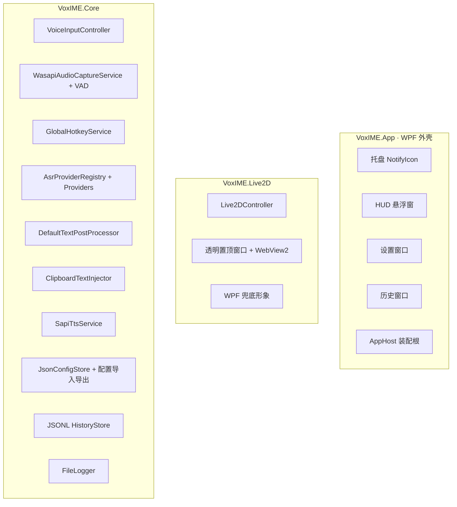
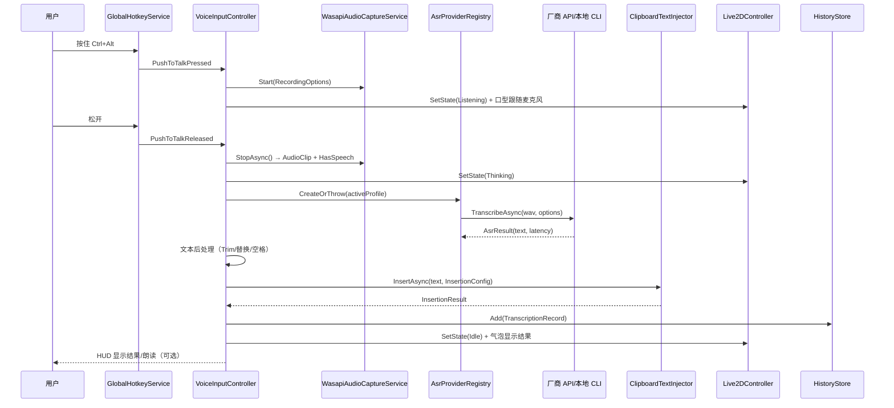
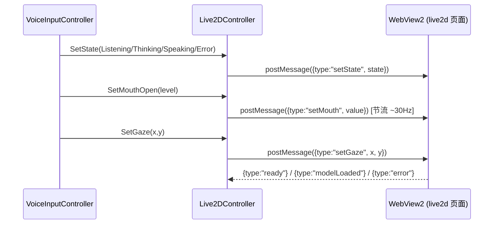

# VoxIME 架构设计

本文档描述 VoxIME 的模块划分、关键数据流、线程模型、扩展点与已知取舍。面向想二次开发/接入新厂商的工程师。

## 1. 目标与约束

| 目标 | 设计决策 |
|---|---|
| 任意应用可用 | 不做 TSF 输入法注册，采用"全局热键 + 模拟输入/剪贴板粘贴"的悬浮助手形态；对管理员窗口等受限场景给出明确降级（复制到剪贴板） |
| 多厂商可插拔 | `IAsrProvider` + `AsrProviderRegistry`，所有厂商差异封装在适配器内，UI 只认 `ProviderProfile` 与 `AsrProviderDescriptor` |
| 识别结果可靠上屏 | 剪贴板粘贴优先（兼容性最好），模拟输入兜底；可配置预览确认 |
| 桌宠可玩但不卡顿 | Live2D 在 WebView2 内由 requestAnimationFrame 渲染；C# 只做状态/参数推送（节流），不逐帧跨进程同步 |
| 隐私 | 配置/历史/日志全部本地；Key 明文保存在本地配置中（可导入导出）；本地 CLI 可完全离线 |
| 可测试 | 所有核心服务通过接口注入；网络/进程/音频/UI 均可替换为 fake |

## 2. 分层与项目结构



| 项目 | 目标框架 | 职责 |
|---|---|---|
| `VoxIME.Core` | `net10.0-windows` | 无 UI 依赖的核心逻辑；可直接被其他前端（WinForms/控制台）复用 |
| `VoxIME.Live2D` | `net10.0-windows10.0.17763.0` + WPF | 桌宠窗口与渲染；对外只暴露 `ILive2DController`。TFM 选择 Win10 1809+ 是为了获得 `WebView2CompositionControl` 所需的 WinRT 投影（`Microsoft.Windows.SDK.NET`），否则透明合成在运行时会缺程序集 |
| `VoxIME.App` | `net10.0-windows10.0.17763.0` + WPF + WinForms | 应用外壳、托盘、界面与服务装配（引用 Live2D，故 TFM 必须对齐） |
| `VoxIME.Core.Tests` | `net10.0-windows` | 核心逻辑单元测试（离线、无真实音频/网络） |

依赖方向：`App → Live2D → Core`，`App → Core`。Core 不引用任何 UI 框架。

## 3. 核心数据流

### 3.1 一次语音输入



### 3.2 自动结束（静音检测）

`WasapiAudioCaptureService` 内部 VAD 在持续静音超过 `AudioConfig.SilenceTimeoutMs`（且已检测到至少 `MinSpeechMs` 语音）或达到最大时长时触发 `AutoStopRequested`；`VoiceInputController` 收到后执行与松键相同的结束流程。按住说话模式下如果用户一直不说话，也会在最大时长后自动结束。

## 4. 线程模型

| 组件 | 线程 | 说明 |
|---|---|---|
| WASAPI 采集 | NAudio 采集线程 | 回调中只做拷贝/电平计算，事件交给订阅方；`StopAsync` 通过 TaskCompletionSource 汇合 |
| 低级键盘钩子 | 钩子线程（OS 调用） | 回调必须极快：只做组合键状态机与事件触发，不做 I/O |
| ASR 网络请求 | 线程池（async/await） | `HttpClient` 共享实例；`CancellationTokenSource` 按 profile 超时 |
| Live2D | WPF UI 线程 | `Live2DController` 内部 `Dispatcher.Invoke/BeginInvoke` 封送所有 UI 操作；参数推送节流 |
| 托盘 | WPF UI 线程（NotifyIcon 在 WinForms 消息循环） | 事件通过 `Dispatcher.BeginInvoke` 回到 UI 线程 |
| 状态事件 | 触发线程 | `StateChanged/LevelChanged` 等由后台线程触发，App 层负责 `Dispatcher` 封送 |

> 约定：Core 内部不假设 UI 线程；UI 层不阻塞等待 Core 事件。

## 5. 关键模块

### 5.1 音频（`VoxIME.Core.Audio`）

- `WasapiAudioCaptureService`：`WasapiCapture` 采集默认/指定设备 → `MediaFoundationResampler`/`WdlResamplingSampleProvider` 转 16kHz 单声道 → 缓存 PCM16 → 25Hz 计算 RMS 触发 `LevelChanged`；默认设备取 Windows「默认设备（Communications 角色）」；如果系统默认被 UU 远程等虚拟麦克风占用，设置页会显示实际设备名并提示改选真实麦克风。
- 设置页「测试麦克风」期间临时关闭提示音（避免虚拟/回录设备把提示音当人声），并显示实际设备名与最大电平。
- `VoiceActivityDetector`（public，可单测）：能量阈值 + 噪声底自适应；静音帧持续计数触发结束判断。默认绝对阈值 0.003（旧默认 0.014 会在 Normalize 时迁移），适配笔记本内置麦克风/远场输入。
- 结束流程：`StopAsync` 停止采集、返回 `RecordingResult`（含是否检测到语音、输入峰值 RMS；无语音时状态提示会带峰值与阈值，便于判断是设备没声音还是阈值偏高）；`Cancel` 丢弃缓冲。

### 5.2 热键（`VoxIME.Core.Hotkeys`）

- `GlobalHotkeyService`：同时安装 `SetWindowsHookEx(WH_KEYBOARD_LL)` 与 `WH_MOUSE_LL`，运行在独立后台线程（自带消息循环），不吞键盘按键；`HotkeyGesture`/`HotkeyMatcher`（public）负责解析 `"Ctrl+Alt"`、`"Ctrl+Shift+Space"`、`"F2"`、`"MouseX1"`、`"Ctrl+MouseX2"` 等手势并驱动"按住说话"状态机：组合键全部按下 → Pressed；任一键抬起 → Released；无自动重复。`HotkeyConfig.PushToTalkGestures` / `ToggleGestures` / `CancelGestures` 支持每个功能多个热键，匹配任意一个即可；旧单值字段仍兼容。`AppConfig.Normalize` 会按 `DefaultMode` 自动启用对应的热键，避免“按一下开始/结束模式已选但切换热键禁用”导致无响应。
- 支持 `Ctrl/Alt/Shift/Win` + 单个键盘主键（最多 4 键组合），也支持鼠标键：`MouseX1`/`MouseX2`（侧键）、`MouseMiddle`、`MouseLeft`、`MouseRight`；`Esc` 作为取消键。
- 鼠标键通过低级鼠标钩子映射为虚拟键码（0x01..0x06）后复用同一个匹配器；**只有命中已配置热键的鼠标事件会被吞掉**（避免浏览器前进/后退等默认行为同时触发），其余鼠标/键盘事件照常传递。
- **钩子回调只入队、不执行业务逻辑**：专用 `VoxIME.HotkeyDispatch` 后台线程按序处理事件。低级鼠标/键盘钩子被阻塞会导致整机输入卡顿（表现为鼠标突然点不动屏幕），因此 `StartRecording` 等重活绝不能跑在钩子线程上。
- 失败（如钩子被占用）通过 `Error` 事件上报，界面提示但应用不崩溃；鼠标钩子安装失败但未配置鼠标热键时只记录警告，不影响键盘热键。

### 5.3 语音识别（`VoxIME.Core.Asr`）

```csharp
public interface IAsrProvider
{
    AsrProviderDescriptor Descriptor { get; }
    Task<AsrResult> TranscribeAsync(AudioClip clip, AsrCallOptions options, CancellationToken ct);
}
```

- `AsrProviderRegistry`：从 `ProviderProfile.TypeId` 创建具体适配器，并暴露 `Descriptors`（供设置页生成表单）与每个适配器的 `Presets`（BaseUrl/Model 默认值）。
- 所有适配器接收 `Profile + HttpClient + IAppLogger`，统一：超时（`TimeoutSeconds`）、取消、HTTP 错误映射为 `AsrException`（含状态码与响应片段）、日志脱敏。
- 统一输入为 16kHz 单声道 PCM16 WAV（`AudioClip.ToWav()`），厂商需要的格式转换在适配器内部完成。

已实现适配器：

| 类 | 协议 | 说明 |
|---|---|---|
| `OpenAiCompatibleTranscriptionProvider` | `POST /audio/transcriptions` multipart | Whisper/SenseVoice/LM Studio 等 |
| `OpenAiAudioChatProvider` | `POST /chat/completions` + `input_audio` | 小米 MiMo-ASR、DashScope qwen3-asr-flash |
| `TencentAsrProvider` | TC3-HMAC-SHA256 → `SentenceRecognition` | 腾讯云一句话识别 |
| `XfyunAsrProvider` | WebSocket IAT | 讯飞实时听写 |
| `LocalCliAsrProvider` | 本地进程 | whisper.cpp / FunASR / sherpa-onnx |
| `MockAsrProvider` | 本地 | 演示与测试 |

### 5.4 文本上屏（`VoxIME.Core.TextInsertion`）

- `DefaultTextPostProcessor`：去控制字符、Trim、术语替换（长串优先）、追加空格。
- `ClipboardTextInjector`：
  1. 备份剪贴板文本 → 写入识别结果 → `SendInput(Ctrl+V)` → 还原剪贴板（可配置）；
  2. 或 `SendInput(KEYEVENTF_UNICODE)` 逐字输入（支持中文与代理对，速度较慢但不污染剪贴板）。
- 受限场景（管理员窗口、部分全屏程序）粘贴失败时：返回失败并把文本保留在剪贴板，HUD 提示复制成功。

### 5.5 朗读（`VoxIME.Core.Tts`）

`SapiTtsService`：`SpeechSynthesizer` 合成到内存 WAV → NAudio `WaveOutEvent` 播放；播放过程中按块计算 RMS 触发 `LevelChanged`，用于 Live2D 口型；无中文语音包时 `IsAvailable=false`，调用静默失败不影响主流程。

### 5.6 桌宠（`VoxIME.Live2D`）



- 窗口：无边框、透明、置顶、`ShowInTaskbar=false`；点击穿透通过 `WS_EX_TRANSPARENT` + `WM_NCHITTEST=HTTRANSPARENT` 实现；关闭穿透后支持拖动。
- 渲染：`WebView2CompositionControl`（WPF 合成，支持透明）承载本地网页；网页用 PixiJS 8 + untitled-pixi-live2d-engine（Cubism 5 SDK）渲染 `.model3.json`；`renderer.backgroundAlpha=0` 保证透明。
- 降级链：WebView2 不可用 / 模型加载失败 / 未配置模型 → WPF 内置矢量兜底形象（呼吸、眨眼、口型、聆听波纹、思考/出错动画）。
- 状态映射：Idle（待机动作循环 + 随机眨眼）、Listening（表情 + 口型跟随麦克风）、Thinking（思考动作/表情）、Speaking（口型跟随 TTS 音量）、Error（抖动/红色提示）。动作默认按同名动作组匹配；设置页支持按模型配置待机动作组与四个状态动作（自动/不播放/指定组），并可即时「预览」动作/表情。
- 眼动：独立后台线程按 `Live2DConfig.EyeFollowFps`（5–300Hz，默认 30）采样全局光标位置，归一化为 `-1..1`（上下方向已修正）；UI 渲染帧（`CompositionTarget.Rendering`，通常等于显示器刷新率）再把最新值下发给模型，避免高频 DispatcherTimer 挤占 UI 线程导致抖动；`EyeFollow=false` 时停止采样并归零。部分模型骨骼绑定把上下方向做反，提供 `EyeFollowInvertY`（按模型目录记忆于 `EyeFollowInvertYByModel`），只反转下发给 WebView2 模型的 Y，WPF 兜底形象不受影响。
- 模型资源目录：`VoxIME.Core.Services.Live2DModelAssetCatalog` 扫描 `model3.json` 的 `Expressions/Motions` 以及 VTube Studio 常见的 `Exp3/*.exp3.json`、`Animation/*.motion3.json`；页面在 `Live2DModel.from` 前把这些资源合并进 settings（否则无 `Expressions` 的模型不会创建 expressionManager），再注册到引擎。状态表情/动作映射分别支持 `Live2DConfig.ExpressionByModel` / `MotionByModel` 按模型记忆；动作预览通过 `ILive2DController.PreviewMotion` → `{type:"previewMotion"}` 直接下发。
- 窗口置顶：WPF `Topmost` 之外，PetWindow 每 3 秒用 Win32 `SetWindowPos(HWND_TOPMOST, SWP_NOACTIVATE)` 重新断言，避免远程桌面/其它顶层窗口导致置顶被覆盖。
- 模型库：`VoxIME.Core.Services.Live2DModelLibrary` 负责扫描/导入/删除模型库目录（默认 `%APPDATA%\VoxIME\models`，可由 `Live2DConfig.ModelLibraryDirectory` 改到其它磁盘；支持文件夹与 zip，重名自动编号，禁止删除库外目录）；设置页「选择模型」下拉框包含「内置兜底形象」+ 已导入模型（旧配置的外部目录会显示为「当前模型（外部目录）」），选择后只把 `Live2DConfig.ModelDirectory` 写入配置，桌宠加载逻辑不变。
- 窗口自适应：模型加载成功后由 `VoiceInputController` 收到 `ILive2DController.ModelSizeAvailable`，用 `Live2DWindowSizing` 以当前高度和渲染缩放反推模型显示宽度，窗口宽度 = 模型显示宽度 + 左右各 5 DIP padding；高度不变，结果保存到 `Live2DConfig.Width/Height`。缩放/高度/开关变化后也会重新计算，可在设置页关闭 `AutoFitWindow`；模型尺寸由页面 `modelLoaded` 消息上报。

### 5.7 主控制器（`VoxIME.Core.Services.VoiceInputController`）

- 状态机：`Idle ⇄ Listening → Recognizing → (Inserting) → Speaking? → Idle`；异常进入 `Error`，3.5s 后自动回 `Idle`；暂停进入 `Disabled`。
- 职责：热键订阅、录音生命周期、调用识别/后处理/上屏、历史写入、朗读、桌宠状态与口型、错误提示、配置热应用。
- 事件：`StateChanged`、`TranscriptionReceived`、`MicrophoneLevelChanged`、`ErrorOccurred`。
- 并发保护：录音生命周期 `lock`；识别用 `SemaphoreSlim` 串行；取消走 `CancellationToken` + `Cancel()`。

## 6. 配置与持久化

- `AppConfig` 全部字段带默认值，`Normalize()` 负责钳制范围、修复空 ID/重复 ID、补齐默认服务（Mock）。
- `JsonConfigStore`：原子写入（临时文件 + `File.Replace`）；损坏文件自动备份为 `config.bad.json` 并回退默认；`ConfigChanged` 通知 UI。
- 凭据：`ProviderProfile.ApiKey/ApiSecret/SecretId` 直接以明文写入 `config.json`，便于配置备份/迁移；旧版 `*Protected` DPAPI 字段仅用于加载时迁移，迁移后清空。
- 配置交换：`ConfigExchangeService` 导出/导入 JSON，可选择是否包含 API Key；导入前由 UI 备份当前配置，导入只替换设置，不动历史/日志/模型。
- 历史：JSONL 追加写，最多保留 1000 条，读取跳过损坏行。

## 7. 错误处理与降级

| 场景 | 行为 |
|---|---|
| 热键钩子安装失败 | 记录日志 + HUD/托盘提示，应用可用但需手动开始 |
| 麦克风不可用 | 状态设为 Error 并提示检查权限/设备 |
| 识别失败/超时 | 历史记录标记错误、HUD 提示、桌宠 Error 动画，3.5s 回待机 |
| 上屏失败 | 文本保留在剪贴板并提示复制成功 |
| 无语音包 | TTS 静默禁用，不影响识别 |
| WebView2/模型失败 | 自动降级 WPF 兜底形象并记录 `LastError` |
| 全局异常 | `App` 捕获 `DispatcherUnhandledException`/`AppDomain` 未处理异常，写日志并友好提示 |

## 8. 扩展新的语音识别厂商

1. 在 `src/VoxIME.Core/Asr/Providers/` 新建类实现 `IAsrProvider`：
   ```csharp
   public sealed class MyVendorProvider : IAsrProvider
   {
       public MyVendorProvider(ProviderProfile profile, HttpClient http, IAppLogger logger) { ... }
       public AsrProviderDescriptor Descriptor => ...;
       public async Task<AsrResult> TranscribeAsync(AudioClip clip, AsrCallOptions options, CancellationToken ct) { ... }
   }
   ```
2. 在 `AsrProviderTypeIds` 增加类型常量（需 Lead 评审公共契约）。
3. 在 `AsrProviderRegistry.Create` 中注册创建逻辑，并在 `AsrProviderCatalog` 中加入 `AsrProviderDescriptor` + 预设（BaseUrl/Model/必填字段）。
4. 为请求构造/响应解析写离线单测（自定义 `HttpMessageHandler`）。
5. 在 `docs/providers.md` 补充字段说明与示例。

## 9. 发布与运行要求

- 目标：Windows 10 1809+ / Windows 11，x64；自包含发布包含 .NET 10 运行时。提供 per-user Inno Setup 安装包（默认 `%LOCALAPPDATA%\Programs\VoxIME`，不弹 UAC，卸载保留 `%APPDATA%\VoxIME` 用户数据）。
- WebView2：Win11 自带；Win10 需安装 Evergreen Runtime（程序检测失败时降级兜底）。
- 音频：WASAPI 共享模式，默认设备/指定设备；16kHz 单声道。
- 建议以普通用户权限运行；要对管理员窗口上屏时以管理员身份运行。

## 10. 已知限制

- 非 TSF 输入法：无法出现在语言栏、无法在 UAC 提权窗口注入（受 UIPI 限制）。
- 批量识别模式：当前是"录完整段再识别"，首字延迟取决于厂商接口；流式识别列入 v0.2。
- Live2D 支持 Cubism 3/4/5（含 MOC3 v5）；不支持 Cubism 2（旧模型需转换）。
- 未做自动更新与代码签名；SmartScreen 可能提示"未识别的应用"。
- 仅 Windows；macOS/Linux 需重写 PDF/音频/UI 三部分。

## 11. 验证方式与踩坑记录

### 11.1 自动化验证

| 层级 | 方式 | 命令/产物 |
|---|---|---|
| 单元测试 | 354 个离线 xUnit 测试（音频/VAD/热键（含鼠标侧键）/剪贴板/TTS/ASR 协议/配置/历史/主控制器流程） | `dotnet test` |
| 窗口级自检 | 构造并显示欢迎/设置/历史/关于/HUD 五个窗口后退出 | `VoxIME.exe --tray --selftest`（日志 `SELFTEST` 行，退出码 0/2） |
| 端到端 | 真实启动应用 → 录音 3 秒 → 识别 → 上屏到一个真实前台 WinForms 文本框；结果写 JSON；支持 `-ForceAudioWav` 用指定 WAV 走真实厂商接口 | `scripts/e2e-smoke.ps1` → `%TEMP%\voxime-e2e-result.json` |
| 真实厂商联调 | Windows SAPI 合成中文语音 → 应用完整链路（强制 WAV）→ 小米 MiMo ASR → 上屏；HTTP 200，识别结果与原文逐字一致，上屏内容与识别结果一致 | `docs/verification/e2e-mimo-real-asr.json` |
| 桌宠透明性 | 棋盘格底窗 + 隐藏/显示桌宠前后像素对比，四角 cornerMaxDiff=0；`WS_EX_TRANSPARENT`/`WM_NCHITTEST` 校验 | `docs/verification/live2d-desktop-pet.json` |
| 眼动跟随 | 光标移到屏幕左右两侧各截一张桌宠窗口图：头部区域像素变化 7.2%、虹膜 bbox 平移 9px；兜底形象瞳孔区域变化 18.9%；预览页 gaze=±1 回读 `ParamAngleX` 25.2/-23.8 | `docs/verification/eye-follow.json` |
| 网页渲染 | Edge headless + CDP 读取 `ParamMouthOpenY`/`EyeBallX` 等参数，fps 统计 | `docs/screenshots/live2d-preview.png` |

### 11.2 两个真实踩坑（复现与修复）

**① `WebView2CompositionControl` 初始化期间不能被折叠。**
`EnsureCoreWebView2Async` 需要控件处于 `Visible` 且有有效渲染目标；如果初始化过程中把控件 `Visibility` 设为 `Collapsed`（本项目曾因 `Live2DController.Show()` 内部调用 `SetFallbackVisible(true)` 而触发），初始化会**永久挂起**，随后只能降级为兜底形象。修复：初始化期间只切换兜底形象的可见性（`PetWindow.SetAvatarVisible`），绝不改 WebView 的可见性；等页面/模型就绪后再 `SetWebViewVisible(true)`。

**② 透明合成依赖 WinRT 投影。**
`WebView2CompositionControl` 运行时需要 `Microsoft.Windows.SDK.NET`（WinRT 投影），因此 `VoxIME.Live2D` 与引用它的 `VoxIME.App` 必须使用 `net10.0-windows10.0.17763.0`（Win10 1809+）；`net10.0-windows`（windows7.0）会编译通过但运行时 `FileNotFoundException`。Core/Tests 保持 `net10.0-windows` 即可。

### 11.3 手动验收清单

- [x] 解压发布包直接运行（无 .NET SDK）
- [x] 托盘图标/菜单/双击打开设置
- [x] 设置六页签保存后热键/桌宠/朗读立即生效
- [x] 无模型 → 内置矢量兜底形象；选择 Hiyori 模型 → 透明桌宠 + 待机/口型/眼动/气泡
- [x] 关闭穿透后桌宠可拖动；点击穿透开启时鼠标事件穿透到桌面
- [x] 无 WebView2 / 模型损坏 → 自动降级并给出 `LastError`
- [x] 终止网络后 Mock/本地 CLI 仍可完成识别与上屏
- [x] 配置、历史、日志均落 `%APPDATA%\VoxIME`，JSON 中无明文 Key

