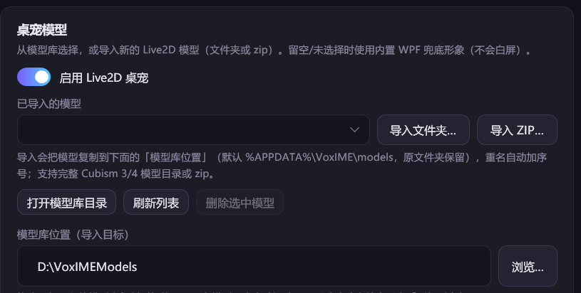

# VoxIME Live2D 桌宠子系统（D）

> 本文档覆盖 `src/VoxIME.Live2D`、`assets/live2d/**`、`scripts/fetch-sample-model.ps1` 的
> 实现说明、模型格式要求、参数映射、许可合规、预览/截图方法与排错。
> 最后更新：2026-11-01（VoxIME 0.1.0 开发期）。

## 1. 总体架构

```
┌─────────────────────────────── WPF 应用（VoxIME.App）───────────────────────────────┐
│  Live2DController（ILive2DController 实现，任意线程安全）                            │
│   ├─ PetWindow（透明 / 无边框 / 置顶 / 不占任务栏 / 点击穿透可配 / 可拖动）          │
│   │   ├─ WebView2CompositionControl ──► 本地网页（assets/live2d/wwwroot）            │
│   │   │      └─ PixiJS 8 + Cubism 5 引擎（untitled-pixi-live2d-engine）+ Live2D Cubism Core       │
│   │   │      └─ 虚拟主机：https://voxime.live2d/（应用资源）                          │
│   │   │                   https://voxime.models/（用户模型目录，Allow CORS）         │
│   │   ├─ FallbackAvatar（WPF 矢量兜底形象，无模型/WebView2 不可用时显示）             │
│   │   ├─ BubbleView（气泡，WPF 层渲染）                                              │
│   │   └─ DragLayer（非穿透模式下的拖动层）                                           │
│   └─ 30Hz 合帧下发：状态 / 口型 / 眼动 / 气泡 → WebView2 JS / WPF 兜底形象           │
└─────────────────────────────────────────────────────────────────────────────────────┘
```

设计要点：

- **真透明**：普通 `WebView2` 控件是 HWND 子窗口，在 `AllowsTransparency=True` 的 WPF
  分层窗口里只能得到不透明色块。因此使用 `Microsoft.Web.WebView2.Wpf.WebView2CompositionControl`
  （WPF 合成控件，D3DImage + DirectComposition），配合
  `DefaultBackgroundColor = Transparent` 与网页 `background: transparent`，实现 per-pixel 透明，
  模型边缘可以直接压在桌面壁纸/其他窗口上。
- **线程模型**：`ILive2DController` 的接口方法可能从任意线程调用。高频接口
  （`SetMouthOpen`/`SetGaze`/`SetState`/`SetBubbleText`）只写入加锁字段；UI 线程上
  33ms 定时器读取并**合并**后下发到 JS 与 WPF 兜底形象，避免跨线程访问 WPF 与消息洪泛。
  `Initialize`/`ApplyConfig`/`Show`/`Hide` 通过 `Application.Current.Dispatcher` 封送。
- **自动降级**：任何一环失败（无 WebView2 Runtime、页面握手超时、模型加载失败、模型目录
  无效）都自动切换到 WPF 矢量兜底形象，并通过 `ErrorOccurred` / `LastError` 明确报告，
  桌宠窗口永远不会是空白/白块。
- **无 npm 构建**：网页端全部为原生 JS + 提前下载到 `vendor/` 的 UMD 运行库，可完全离线运行。

## 2. 目标框架与系统要求

| 项目 | 要求 |
|---|---|
| `src/VoxIME.Live2D` TargetFramework | **`net10.0-windows10.0.17763.0`** |
| `src/VoxIME.App` TargetFramework | 必须同样为 `net10.0-windows10.0.17763.0`（否则 ProjectReference 报 NU1201） |
| 操作系统 | Windows 10 1809（build 17763）及以上；已在 Windows 11 + .NET 10 验证 |
| WebView2 Runtime | Evergreen Runtime（本机验证版本 156.0.4314.58）；未安装时自动降级兜底形象 |
| 显卡/驱动 | 任意支持 D3D11 的显卡；WebGL 由 WebView2 走 ANGLE/D3D11（无需手动配置） |

**为什么必须提升 TFM？** `WebView2CompositionControl.TryInitializeD3DImage()` 在运行时会解析
WinRT 投影程序集 `Microsoft.Windows.SDK.NET`；`net10.0-windows`（即 windows7.0）不会引入该投影，
运行时抛 `FileNotFoundException: Microsoft.Windows.SDK.NET`。改为 `net10.0-windows10.0.17763.0`
后 .NET SDK 自动引用 `Microsoft.Windows.SDK.NET.Ref` 框架包，构建输出会包含
`Microsoft.Windows.SDK.NET.dll`（约 23MB）与 `WinRT.Runtime.dll`。这是**全解决方案中唯一使用
Windows 10 SDK TFM 的项目**，Core/Tests 保持 `net10.0-windows` 不受影响。

> 注意：`VoxIME.Live2D.csproj` 设置了 `CopyLocalLockFileAssemblies=true`，因此单独
> `dotnet build src/VoxIME.Live2D/VoxIME.Live2D.csproj` 后，输出目录
> `bin/Debug/net10.0-windows10.0.17763.0/` 里能直接看到 WebView2 / WinRT 投影依赖，
> 便于集成期核对；宿主 exe（VoxIME.App）的 `dotnet publish win-x64 --self-contained` 也会自动带上。

## 3. 目录结构与资源

```
src/VoxIME.Live2D/
├─ VoxIME.Live2D.csproj          # TFM/依赖/资源复制规则
├─ Live2DController.cs           # ILive2DController 实现（窗口/内容/降级/合帧）
├─ Live2DWebHost.cs              # WebView2CompositionControl 宿主 + 虚拟主机 + JS 桥
├─ PetWindow.cs                  # 透明置顶窗口、点击穿透、拖动、气泡层
├─ FallbackAvatar.cs             # WPF 矢量兜底形象（呼吸/眨眼/口型/波纹/转圈/抖动）
├─ BubbleView.cs                 # 气泡控件
├─ WindowInterop.cs              # WS_EX_TRANSPARENT / WM_NCHITTEST / GetWindowRect
└─ Live2DPositionChangedEventArgs.cs

assets/live2d/
├─ wwwroot/                      # 由 csproj 以 Content 复制到输出 live2d/wwwroot（随程序发布）
│  ├─ index.html                 # 桌宠页（WebView2 嵌入，透明背景）
│  ├─ preview.html               # 独立预览/调试页（Edge headless 截图用）
│  ├─ app.js                     # 页面主逻辑 + JS 桥 + Canvas 兜底形象
│  ├─ styles.css
│  └─ vendor/
│     ├─ pixi.min.js             # PixiJS v8.22.0（MIT，UMD）
│     ├─ cubism5.min.js          # untitled-pixi-live2d-engine v1.4.0 Cubism 5 UMD（MIT）
│     ├─ untitled-pixi-live2d-engine.LICENSE # 引擎 MIT 许可原文
│     └─ live2dcubismcore.min.js # Live2D Cubism Core（官方 CDN，专有许可）
└─ models/                       # 用户/示例模型目录（.gitignore 忽略，不随源码分发）
   └─ Hiyori/                    # scripts/fetch-sample-model.ps1 下载的官方示例模型

src/VoxIME.Live2D/devtools/      # 开发期验证工具（不参与库/解决方案构建）
├─ capture-live2d-screenshots.ps1  # Edge headless + CDP 截图（真实时间等待、参数回读）
└─ Live2DTools/                  # 真实 WPF 窗口启动/截图/透明性与窗口样式校验
```

运行时资源定位不写死绝对路径：优先 `AppContext.BaseDirectory/live2d/wwwroot`，找不到时
从输出目录向上最多 10 级查找 `assets/live2d/wwwroot`（开发期直接运行源码构建的输出也能工作）。

## 4. 支持的模型格式与目录要求

**支持 Cubism 3 / Cubism 4** 的 `.model3.json` 模型（Cubism 2 的 `.model.json` 不支持）。

模型目录要求（示例：`assets/live2d/models/Hiyori/`）：

```
Hiyori/
├─ Hiyori.model3.json      # 必需，模型入口（文件名任意，扩展名固定）
├─ Hiyori.moc3             # 必需，由 Cubism Editor 导出的 moc3
├─ Hiyori.2048/            # 贴图目录（model3.json 内相对路径）
│  ├─ texture_00.png
│  └─ texture_01.png
├─ motions/                # 动作目录（可选但推荐）
│  └─ *.motion3.json
├─ Hiyori.physics3.json    # 可选，物理
├─ Hiyori.pose3.json       # 可选，部件切换
├─ Hiyori.cdi3.json        # 可选，显示名（本实现不使用）
└─ Hiyori.userdata3.json   # 可选
```

- VoxIME 会**递归**查找配置目录下的第一个 `*.model3.json`（优先层级更浅的）。
- 配置路径支持环境变量（`%APPDATA%\VoxIME\models` 等）；路径不存在或找不到 model3.json 时
  进入兜底形象并给出 `LastError`，不会崩溃。
- 模型缺少某些参数/动作组/表情时静默降级，不影响渲染（见第 6 节映射规则）。
- 贴图/动作文件缺失会导致 WebView2 侧加载失败 → 触发 `{type:"error"}` → 自动降级兜底形象。
- 模型目录通过虚拟主机 `https://voxime.models/` 暴露（`Allow` CORS，因为 moc3/贴图是跨源
  fetch 请求）；路径内中文/空格会按 URL segment 转义。
- 用户自带模型可在「设置 → 桌宠 → 选择模型」里导入（见 4.1 模型库），也可以手动放进模型库目录后点「刷新列表」。**VoxIME 不附带任何商业模型。**

### 4.1 模型库导入与切换（推荐）

「设置 → 桌宠 → 选择模型」提供模型库管理：

- **内置兜底形象**：下拉框第一项是「内置兜底形象（无 Live2D 模型）」，选择它即可切回内置矢量形象（不加载模型）。
- **导入文件夹…**：选择包含 `*.model3.json` 的模型目录，VoxIME 会把整个目录复制到
  「模型库位置」（默认 `%APPDATA%\VoxIME\models\<模型名>\`；原目录保留，不改动）。
- **导入 ZIP…**：选择 zip 包（可包含一层模型目录），自动解压后按同样方式导入；
  压缩包内含多个模型时提示分别导入。
- **模型库位置**：默认 `%APPDATA%\VoxIME\models`；点右侧「修改位置…」可换到其它磁盘目录（适合模型很大、C 盘空间不足）。
  只影响之后的导入，已有模型不会自动迁移。
- 导入后出现在下拉框中，选择不同模型即可在多个模型间切换（点击「保存」后应用到桌宠）。
- **打开模型库目录**：直接查看/手动放入模型（手动放入后点「刷新列表」）。
- **删除选中模型**：只删除模型库里的副本（有二次确认），不会影响你原来的文件夹。
- **状态表情映射**：设置页四个状态改为可编辑下拉框，自动扫描 `model3.json` 的 `Expressions` 以及模型目录下的 `Exp3/*.exp3.json`；`Animation/*.motion3.json` 会注册为 `Animation/<文件名>` 动作组，避免和 model3 原生 Idle 组冲突。当前模型没有登记表情时也能识别 VTube Studio 的文件夹资源；映射按模型目录记忆。
- **状态动作映射/预览**：四个状态可分别选择「自动（同名动作组）」「不播放」或具体动作组，待机动作组也可从下拉框选；待机动作在主动作层循环，状态动作/预览动作分别由并行动作层叠加（见 6.5），切换时只停止对应层并把模型参数/部件透明度恢复到加载时的基线，避免「脱捕」这类动作修改的自定义参数残留（不依赖具体模型或参数名）；每项旁「预览」按钮会立即在桌宠上试播当前选择，只播一遍，结束后停 3 秒再恢复待机/状态层（避免 VTube Studio 动作的 Loop 标记导致无限重复）。动作映射同样按模型目录记忆。状态表情旁也有「预览」，可立即应用所选表情，3 秒后恢复默认表情。
- **重置位置**：桌宠状态栏旁的「重置位置」会清除保存的 `Left/Top`，把窗口移回默认位置（开启贴边时回当前屏幕右下角，关闭贴边时当前屏幕居中），下次启动也不会再使用旧位置。
- **自动找回**：启动时以及检测到显示器工作区/虚拟屏尺寸变化时，如果保存的窗口位置已经不在当前桌面可见区域，会自动把它移回当前屏右下角（关闭贴边时居中），避免远程桌面/切换分辨率后“看不到桌宠”。
- 模型名优先取 `*.model3.json` 的文件名（如 `Hiyori.model3.json` → Hiyori），重名自动追加 `(2)`、`(3)`。
- 兼容旧配置：如果 `ModelDirectory` 指向模型库之外的外部目录，下拉框会显示「当前模型（外部目录）：xxx」，
  可以随时切回内置兜底形象。



## 5. 配置项（`Live2DConfig`，见 `VoxIME.Core.Configuration.AppConfig`）

| 字段 | 默认 | 说明 |
|---|---|---|
| `Enabled` | true | 是否启用桌宠子系统；false 时 Initialize 后窗口保持隐藏（显式 `Show()` 仍可显示） |
| `ModelDirectory` | null | 当前模型的目录（由「选择模型」下拉框写入）；null/空 → 内置兜底形象 |
| `ModelLibraryDirectory` | null | 模型库根目录（导入目标）；null/空 → `%APPDATA%\VoxIME\models`；可改到其它磁盘 |
| `Width`/`Height` | 380/560 | 桌宠窗口尺寸（DIP，clamp 160..1600） |
| `ExpressionByModel` | {} | 按模型目录保存四个状态表情映射（旧全局字段作为兼容回退） |
| `MotionByModel` | {} | 按模型目录保存待机+四个状态动作映射（旧全局字段作为兼容回退） |
| `AutoFitWindow` | true | 模型加载/缩放/高度变化时保持高度，把窗口宽度收紧到模型显示宽度 + 左右各 5 DIP padding（结果持久化）；开启时设置页宽度滑块置灰 |
| `SnapToEdge` | true | **只做下边吸附**：拖到窗口所在显示器底部约 100 DIP 内时贴底（按该显示器工作区/完整屏底边，支持多屏）；只改变 Y/高度，不改 X（不会因贴右边缘水平回弹）；向上拖动不强制回弹，左右上方向不吸附。关闭后使用拖动保存的位置，首次无位置则居中 |
| `KeepAboveTaskbar` | true | 贴边时窗口下边缘保持在任务栏上方（工作区内）；关闭后允许压住任务栏 |
| `Left`/`Top` | -1/-1 | 窗口左上角（DIP）；-1 → 自动吸附主屏工作区右下角；用户拖动后位置会保留 |
| `Opacity` | 0.96 | 整窗透明度（0.2..1.0） |
| `Scale` | 1.0 | 模型缩放（0.2..3.0）：JS 在 canvas 内缩放模型并随缩放提高渲染分辨率，兜底形象用 `RenderTransform`；不再使用 WebView2 `ZoomFactor`（会重排 viewport 导致缩放无效/发糊） |
| `ModelOffsetX` / `ModelOffsetY` | 0 / 0 | 模型在窗口内的偏移（-1..1，按窗口宽/高比例；正值=右/下），用于放大后把模型移进想显示的位置；兜底形象同样生效 |
| `ClickThrough` | true | 点击穿透（`WS_EX_TRANSPARENT` + `WM_NCHITTEST=HTTRANSPARENT`）；false 时可拖动窗口 |
| `AlwaysOnTop` | true | 置顶（`WS_EX_TOPMOST`） |
| `EyeFollow` | true | 眼动跟随开关（`SetGaze` 是否驱动眼球/头部） |
| `EyeFollowInvertY` | false | 眼动上下反转（当前生效值；保存时按当前模型从下面的 map 解析） |
| `EyeFollowInvertYByModel` | {} | 按模型目录记住的上下反转偏好（不同模型骨骼绑定方向可能相反） |
| `IdleMotion` | true | 待机动作循环开关（关闭后停止 Idle 动作组，模型仍保持呼吸/眨眼） |
| `MouthSync` | true | 口型同步开关（关闭后嘴巴闭合） |
| `MouthSensitivity` | 1.0 | 口型灵敏度（0.1..5.0，与输入音量相乘后 clamp 到 0..1） |
| `ShowBubble` | true | 是否显示气泡（false 时忽略 `SetBubbleText`） |
| `IdleMotionGroup` | "Idle" | 待机动作组名（大小写不敏感，精确匹配；找不到时若存在名字包含 `idle` 的动作组（如 `Animation/IDLE`）会自动使用，否则不播放待机动作，不会拿第一个动作组） |
| `ListeningExpression` / `ThinkingExpression` / `SpeakingExpression` / `ErrorExpression` | null | 状态对应的表情名；模型没有该表情时忽略 |
| `ListeningMotionGroup` / `ThinkingMotionGroup` / `SpeakingMotionGroup` / `ErrorMotionGroup` | null | 状态对应的动作组名；null/空=自动同名匹配，`__none__`=不播放，其它=指定组 |
| `FallbackAvatarTheme` | "violet" | 兜底形象主题（当前仅 violet，保留扩展） |

`ApplyConfig` 为热更新：尺寸/位置/透明度/置顶/点击穿透/缩放立即生效；`ModelDirectory` 变化时
会释放旧 WebView2 并按新目录重新加载（加载期间显示兜底形象）。

## 6. 状态 / 参数映射

### 6.1 Live2DState → 动作 / 表情

| 状态 | 动作组查找顺序 | 表情 |
|---|---|---|
| `Idle` | 待机动作组（`IdleMotionGroup`，默认 `Idle`；精确匹配，找不到时自动匹配名字含 `idle` 的组，如 `Animation/IDLE`） | 重置为默认表情 |
| `Listening` | 优先 `ListeningMotionGroup`；未配置时找同名组（`Listening`/`Listen`），否则继续待机 | `ListeningExpression`（若模型有） |
| `Thinking` | 优先 `ThinkingMotionGroup`；未配置时同名组（`Thinking`/`Think`），否则待机 | `ThinkingExpression` |
| `Speaking` | 优先 `SpeakingMotionGroup`；未配置时同名组（`Speaking`/`Speak`），否则待机；口型由 `SetMouthOpen` 驱动 | `SpeakingExpression` |
| `Error` | 优先 `ErrorMotionGroup`；未配置时同名组（`Error`），否则待机 | `ErrorExpression` |

约定：模型没有对应动作组/表情时**静默保持待机**，不报错、不崩溃（Hiyori 只有 `Idle`/`TapBody`，
因此所有非 Idle 状态都表现为继续待机动作 + 口型/眼动变化）。状态动作不再停止待机动作，而是叠加在待机层上，见 6.5。

### 6.2 口型（SetMouthOpen 0..1）

1. `Live2DController.SetMouthOpen(value)`：任意线程写入，值 clamp 到 0..1。
2. UI 线程 33ms 合帧：乘以 `MouthSensitivity` 后下发 `{type:"setMouth", value}`。
3. 网页在每帧 `beforeModelUpdate` 阶段（Cubism 动作更新之后、`coreModel.update()` 之前）写参数：
   - 优先使用 `model3.json` 中 `Groups.LipSync.Ids`（Hiyori 为 `ParamMouthOpenY`）；
   - 没有声明时回退标准参数 `ParamMouthOpenY`；
   - 模型无该参数时通过 `getParameterIndex >= 0` 过滤，写入失败静默忽略。
4. 平滑：页面侧用 16Hz 系数把数值插值到目标值，避免 30Hz 消息产生阶梯感。

### 6.3 眼动（SetGaze -1..1）

- 输入归一化到 -1..1；`EyeFollow=false` 时强制归零。
- 网页侧调用 `model.internalModel.focusController.focus(x, y)`，由 CubismWebFramework 的
  `updateFocus()` 写入：
  - `ParamEyeBallX` = x（-1..1），`ParamEyeBallY` = y
  - `ParamAngleX` = 30 × x（-30..30），`ParamAngleY` = 30 × y
  - 平滑由 `focusController` 内部阻尼完成，无需额外插值。
- 若模型没有这些参数，Cubism Core 的安全写入逻辑会忽略（不报错）。
- **不同模型的骨骼绑定可能把 `ParamEyeBallY`/`ParamAngleY` 的上下方向做反**：设置页提供
  「眼动上下反转」（`EyeFollowInvertY`），会按模型目录记忆（`EyeFollowInvertYByModel`）。
  该反转只作用于 WebView2 模型，WPF 兜底形象始终保持正确方向。
- 眨眼：`model3.json` 声明了 `Groups.EyeBlink.Ids` 时由 Cubism 自动眨眼（Hiyori 为
  `ParamEyeLOpen`/`ParamEyeROpen`）；模型未声明 EyeBlink 组时不会眨眼。待机动作循环期间 Cubism 会跳过自动眨眼，
  网页由 `applyBlinkLayer` 按同一组参数手动补眨眼（见 6.5）；模型没有眼睛参数时跳过。
- 呼吸：CubismWebFramework 的 `updateNaturalMovements` 自动驱动（`ParamBreath` 等）。

### 6.4 气泡

- `SetBubbleText(text)`：WPF 层 `BubbleView` 渲染（深色半透明卡片 + 紫色描边 + 淡入淡出），
  同时下发 JS `{type:"setBubble"}`。
- 嵌入模式下网页**不重复显示**气泡（由 WPF 层负责）；独立预览页会显示网页内气泡便于截图。
- 10 秒未更新自动隐藏；`ShowBubble=false` 时忽略。
- 空字符串/null 立即隐藏。


### 6.5 动作分层与程序层

- 主动作层：`IdleMotionGroup` 由主 `MotionManager` 循环播放，保留 Cubism 的呼吸/物理。
- 并行动作层：
  - `state`：分发给 `listening` / `thinking` / `speaking` / `error` 的动作，叠加在待机层上；
  - `preview`：设置页「预览」的动作，最高层，只播一遍，结束并冷却 3 秒后停止。
- 更新顺序：主动作 → state 层 → preview 层 → 表情 → 焦点/呼吸/物理 → `beforeModelUpdate`
  程序层 → `coreModel.update()`。后更新的层覆盖先更新的同名参数，因此可以同时看到待机、
  状态和预览动作。
- 程序层 `applyBlinkLayer`：待机动作循环期间 Cubism 的 `updateMotions()` 返回 true，会跳过自动
  EyeBlink；网页按 `model3.json` 的 `Groups.EyeBlink.Ids`（没有时回退
  `ParamEyeLOpen`/`ParamEyeROpen`）在程序层手动眨眼。模型没有可用眼睛参数时整层跳过。
- 模型缺少某个动作组/表情时对应层静默不启动，不影响其它层。
## 7. C# ↔ JS 消息协议

### 7.1 C# → JS（`CoreWebView2.PostWebMessageAsJson`）

```jsonc
{ "type": "setConfig", "eyeFollow": true, "idleMotion": true, "mouthSync": true, "scale": 1.0,
  "idleMotionGroup": "Idle", "showBubble": true,
  "expressions": { "listening": null, "thinking": null, "speaking": null, "error": null },
  "motions": { "listening": null, "thinking": null, "speaking": null, "error": null },
  "modelAssets": { "expressions": [], "motions": [] } }
{ "type": "previewMotion", "group": "Idle" }
{ "type": "previewExpression", "name": "exp_01" }
{ "type": "loadModel", "url": "https://voxime.models/Hiyori.model3.json" }
{ "type": "setState", "state": "idle|listening|thinking|speaking|error" }
{ "type": "setMouth", "value": 0.0 }
{ "type": "setGaze", "x": 0.0, "y": 0.0 }
{ "type": "setBubble", "text": "你好" }          // null 隐藏
```

### 7.2 JS → C#（`CoreWebView2.WebMessageReceived`）

```jsonc
{ "type": "ready", "version": "1.0.0", "page": "pet", "webgl": true }
{ "type": "modelLoaded", "name": "Hiyori" }
{ "type": "error", "message": "找不到模型文件（已尝试相对路径）: ..." }
```

### 7.3 握手时序

```
Controller                        WebView2 页面
   │ 导航 index.html?embedded=1        │
   │──────────────────────────────────►│ 加载 vendor/app.js
   │◄──────────── {ready} ─────────────│
   │ 下发 setConfig + loadModel         │
   │──────────────────────────────────►│ fetch model3/moc3/贴图，加载模型
   │◄──────── {modelLoaded, name} ─────│
   │ 显示 WebView2，隐藏 WPF 兜底形象    │
```

超时与降级：

- 页面 `ready` 握手超时 **10s** → 降级兜底形象 + `ErrorOccurred`；
- 模型加载超时 **20s** 或收到 `error` → 降级兜底形象 + `ErrorOccurred`；
- WebView2 环境/控件初始化超时 **25s**（含未安装 Runtime）→ 降级兜底形象；
- 模型加载成功后 WebView2 进程崩溃（`ProcessFailed`）→ 重新切回兜底形象。

## 8. 降级行为与语义

| 场景 | 表现 | `IsAvailable` | `LastError` | 事件 |
|---|---|---|---|---|
| 未配置模型（`ModelDirectory` 为空） | 内置兜底形象（正常用法） | true | null | `Ready` |
| 模型目录不存在 / 找不到 model3.json | 兜底形象 | true | 具体原因 | `ErrorOccurred` + `Ready` |
| WebView2 Runtime 未安装 / 初始化失败/超时 | 兜底形象 | true | 具体原因 | `ErrorOccurred` + `Ready` |
| 页面握手超时 / 页面报错 / 模型加载失败 | 兜底形象 | true | 具体原因 | `ErrorOccurred` + `Ready` |
| 模型加载成功后 WebView2 进程崩溃 | 切回兜底形象 | true | 具体原因 | `ErrorOccurred` |
| 没有 WPF `Application`（控制台/测试进程） | 不创建任何 UI，所有接口安全 no-op | **false** | "当前进程没有 WPF Dispatcher…" | `ErrorOccurred` |
| 窗口/初始化抛异常 | 兜底形象（尽力） | true | 异常摘要 | `ErrorOccurred` |

语义约定：

- `IsAvailable` = 桌宠子系统可用（**包含**内置兜底形象）。`false` 仅表示环境不满足（无 WPF
  Application）等无法显示桌宠的情况。
- `LastError` = 最近一次错误/降级原因；成功加载真实模型后清空；错误去重窗口 2 秒。
- `Ready` 在首次展示完成（模型加载成功或兜底形象就绪）后**只触发一次**；降级场景会先
  `ErrorOccurred` 再 `Ready`。
- `UsingFallbackAvatar`（附加属性）可用于诊断当前是否在使用兜底形象。
- `PositionChanged`（附加事件）在用户拖动窗口后触发，宿主可据此把 `Left/Top` 持久化到配置。

## 9. 开发期预览与截图

### 9.1 准备示例模型（Hiyori）

```powershell
pwsh -NoProfile -ExecutionPolicy Bypass -File scripts/fetch-sample-model.ps1
# 默认下载到 assets/live2d/models/Hiyori（GitHub raw 优先，失败回退 Git Blob API；不依赖 git/npm）
```

脚本会打印许可提示、校验文件完整性，并输出预览/截图命令。`assets/live2d/models/` 已被
`.gitignore` 忽略，示例模型不随源码分发。

### 9.2 本地静态服务器 + 浏览器预览

```powershell
cd assets/live2d
# 任选一种静态服务器；用 Python 时：
python -m http.server 8765 --bind 127.0.0.1
# 浏览器打开（preview.html 的 model 参数相对 assets/live2d 根）：
#   http://127.0.0.1:8765/wwwroot/preview.html?model=../models/Hiyori/Hiyori.model3.json
```

`preview.html` 支持的 URL 参数：

| 参数 | 说明 |
|---|---|
| `model=<路径>` | `.model3.json` 相对/绝对路径；相对路径依次尝试 `./models/`、`../models/`、当前目录（也支持 `https://voxime.models/...`） |
| `bg=checker\|desktop\|solid\|transparent` | 背景：棋盘格（默认，证明透明）/ 模拟桌面壁纸 / 深色纯色 / 透明 |
| `state=idle\|listening\|thinking\|speaking\|error` | 初始状态 |
| `mouth=0..1` | 初始口型 |
| `gaze=x,y` | 初始眼动（-1..1） |
| `bubble=<文字>` | 初始气泡（URL 编码） |
| `demo=1` | 强制显示不改用模型的 **Canvas 兜底演示图形**（验证无模型时页面行为） |
| `status=1` | 显示调试状态（模型/动作组/状态/口型/更新帧参数回读/fps/来源 URL） |

`index.html` 支持 `?embedded=1`（嵌入模式：隐藏页面气泡、不自动加载模型），由 C# 侧通过
消息桥驱动，实际运行时 URL 为 `https://voxime.live2d/wwwroot/index.html?embedded=1&host=1`。

### 9.3 Edge headless 截图（简单方式，注意 WebGL/动画限制）

```powershell
# 简单模式：--virtual-time-budget 会快进虚拟时钟，pixi 的 requestAnimationFrame 基本不驱动，
# 截不到口型/眼动更新（状态栏 fps=0）。仅适合快速确认“模型能渲染出来”。
msedge --headless=new --enable-unsafe-swiftshader --hide-scrollbars `
  --window-size=800,1000 --virtual-time-budget=10000 `
  --screenshot=docs/screenshots/live2d-preview.png `
  "http://127.0.0.1:8765/wwwroot/preview.html?model=../models/Hiyori/Hiyori.model3.json&bg=checker"
```

**推荐方式**：使用仓库内开发期脚本（真实时间等待 + DevTools 协议 + 参数回读）：

```powershell
pwsh -NoProfile -ExecutionPolicy Bypass -File src/VoxIME.Live2D/devtools/capture-live2d-screenshots.ps1 `
  -Url "http://127.0.0.1:8765/wwwroot/preview.html?model=../models/Hiyori/Hiyori.model3.json&bg=checker&state=speaking&mouth=0.9&gaze=0.85,-0.45&bubble=%E4%BD%A0%E5%A5%BD&status=1" `
  -OutFile docs/screenshots/live2d-preview.png -Width 800 -Height 1000 -WarmupMs 8000 `
  -Evaluate "JSON.stringify(window.__voxime.debug())"
```

脚本会用 CDP 打开 headless 浏览器，按**真实时间**等待模型/动画稳定后截图，并打印
`window.__voxime.debug()`（含更新帧参数回读、动作组、fps），可作为“渲染循环确实在跑”的证据。

### 9.4 真实窗口截图 + 自动化校验（推荐验收方式）

`src/VoxIME.Live2D/devtools/Live2DTools` 是开发期 WPF 验证工具（**不属于库/解决方案**）：

```powershell
dotnet build src/VoxIME.Live2D/devtools/Live2DTools/Live2DTools.csproj
$exe = "src/VoxIME.Live2D/devtools/Live2DTools/bin/Debug/net10.0-windows10.0.17763.0/VoxIME.Live2D.Tools.exe"

# 1) WPF 兜底形象五状态截图 + 拼图
& $exe avatar --out docs/screenshots/avatar-tmp

# 2) 真实 Live2D 桌宠窗口：启动 Controller + Hiyori，截屏并做透明性/窗口样式校验
& $exe pet --model assets/live2d/models/Hiyori --out docs/screenshots/live2d-desktop-pet.png `
          --result docs/screenshots/live2d-desktop-pet.json --idlemotion 0

# 3) 兜底形象真实窗口（未配置模型）
& $exe fallback --out docs/screenshots/live2d-wpf-fallback.png --result docs/screenshots/live2d-wpf-fallback.json

# 4) 降级路径（配置了模型但强制禁用 WebView2 => ErrorOccurred + LastError）
& $exe fallback --model assets/live2d/models/Hiyori --out docs/screenshots/live2d-wpf-fallback-degraded.png

# 5) 无 WPF Application 场景安全降级
& $exe noapp --out docs/screenshots/verification
```

工具做了什么：

1. 创建 WPF `Application` + `Live2DController`，使用 420×600 真实透明置顶窗口；
2. 等待 `Ready`，设置 `Speaking` 状态 / 口型 0.85 / 眼动 / 气泡，等待动画稳定；
3. 从屏幕捕获桌宠窗口区域（真实桌面壁纸背景）；
4. 在窗口下方垫一个静态棋盘格背景窗，隐藏桌宠后再截同一区域，比较四角像素 —— 四角
   完全一致（`cornerMaxDiff=0`）即证明窗口 per-pixel 透明；变化像素集中在模型/气泡范围；
5. 用 `FindWindow` + `GetWindowLongPtr` 校验 `WS_EX_TRANSPARENT`/`WS_EX_TOOLWINDOW`/
   `WS_EX_TOPMOST`，并用 `WM_NCHITTEST` 消息验证穿透返回 `HTTRANSPARENT(-1)`；热更新
   `ClickThrough=false` 后重新校验 `WS_EX_TRANSPARENT` 已清除且命中测试返回 `HTCLIENT(1)`。

### 9.5 已生成截图与验证结果（docs/screenshots/）

| 文件 | 内容 | 验证结果（对应 JSON） |
|---|---|---|
| `live2d-preview.png` | 真实 Hiyori 模型 + 棋盘格透明背景 + 气泡/状态栏（Edge headless/CDP，800×1000） | 状态栏：fps=144、`MouthOpenY=0.90`、`EyeBallX=0.83`、动作组 Idle/TapBody、更新帧参数回读 |
| `live2d-preview-desktop.png` | 真实模型 + 模拟桌面壁纸背景（浏览器预览） | fps=144、模型加载成功、眼动生效 |
| `live2d-fallback-demo.png` | 无模型时的 **Canvas 兜底演示**（纯 Canvas 绘制，棋盘格背景） | `demoActive=true`、fps=144、口型/气泡正常 |
| `live2d-desktop-pet.png` | **真实透明桌宠窗口 + Hiyori 模型**压在真实桌面壁纸上（420×600 DIP @125% DPI = 525×750 px） | `live2d-desktop-pet.json`：`ready=true`、`isAvailable=true`、`usingFallbackAvatar=false`、`cornerTransparent=true`（cornerMaxDiff=0）、`WS_EX_TRANSPARENT/TOOLWINDOW/TOPMOST=true`、`hitTest=-1(HTTRANSPARENT)`、关闭穿透后 `hitTest=1` |
| `live2d-desktop-pet.transparency.png` | 同上，但垫静态棋盘格背景窗（窗口级透明性证明） | 见 JSON `changedBounds`：变化区域仅模型+气泡（142,12,240,706），四角透明 |
| `live2d-wpf-fallback.png` | 未配置模型时的 **WPF 兜底形象**透明窗口 + 气泡压在真实桌面壁纸上 | `live2d-wpf-fallback.json`：`usingFallbackAvatar=true`、`lastError=null`（未配置模型属正常用法）、透明性通过 |
| `live2d-wpf-fallback.transparency.png` | 同上，棋盘格背景窗下的透明性校验 | 四角 transparent |
| `live2d-wpf-fallback-degraded.png` | 配置了模型但 WebView2 被禁用 → 降级路径截图 | `live2d-wpf-fallback-degraded.json`：`lastError="已按环境变量禁用 WebView2，使用内置兜底形象。"`、`errors` 非空、仍 `ready/isAvailable=true` |
| `live2d-wpf-fallback-states.png` | 兜底形象五状态拼图（待机/聆听/思考/说话/出错） | 由 `avatar` 模式生成 |
| `live2d-wpf-fallback-avatar.png` | 兜底形象透明单图（待机） | — |
| `verification/live2d-noapp.json` | 无 WPF Application 场景 | `isAvailable=false`、`lastError` 明确、未抛异常 |
| `live2d-desktop-pet.json` / `live2d-wpf-fallback*.json` | 上述验证的原始结果（窗口像素矩形、透明性、窗口样式、事件计数） | 均为 `pass=true` |

> 说明：`live2d-desktop-pet.png` 已裁掉桌面图标区域后再入库；`live2d-wpf-fallback.png` / `live2d-wpf-fallback-degraded.png` 是压在**真实个人桌面**上的截图，涉及本机文件图标，**不随仓库分发**，可按 9.4 节命令在本地重新生成（结果 JSON 已保留在 `docs/verification/`）。

## 10. 性能说明

| 项 | 数值/建议 |
|---|---|
| 渲染循环 | WebView2 内 pixi 60~144fps（取决于显示器刷新率）；C# 侧只以 **30Hz** 合帧推送参数，CPU 占用低 |
| 消息量 | 口型/眼动变化小于阈值（0.004/0.01）不发消息；状态/气泡按变化发送 |
| 显存/内存 | WebView2 进程约 100~200MB（示例 Hiyori 2 张 2048 贴图）；模型面数越高占显存越多 |
| 透明窗口 | `WebView2CompositionControl` 走 D3DImage/DirectComposition，无 CPU 回读；比截屏刷新方案省很多 |
| 省电建议 | 隐藏桌宠时 `Hide()` 会停止 30Hz 合帧定时器；不需要待机动作时可 `IdleMotion=false`；低配机可调小窗口尺寸/Scale |
| 首次加载 | WebView2 环境/页面/模型约 0.5~2s（本机 Hiyori 约 1.5s）；加载期间显示兜底形象，不会白屏 |

## 11. 排错（FAQ）

| 现象 | 原因/处理 |
|---|---|
| 窗口透明区域是白色/黑色块 | 说明走了普通 WebView2 或不支持合成的回退路径。确认项目 TFM 为 `net10.0-windows10.0.17763.0`，输出目录含 `Microsoft.Windows.SDK.NET.dll`；部署时不要只拷 `VoxIME.Live2D.dll` 单文件 |
| `FileNotFoundException: Microsoft.Windows.SDK.NET` | TFM 仍是 `net10.0-windows`；按第 2 节改 TFM（App 也要同步） |
| 桌宠显示兜底形象，`LastError` 提示 WebView2 初始化失败 | 未安装 WebView2 Evergreen Runtime，或显卡/WebView2 进程启动失败；安装 Runtime 后重启应用 |
| 页面握手超时 | 检查 `live2d/wwwroot` 是否随发布复制到输出目录；或用 `Live2DWebHost.ResolveWebRoot()` 的查找逻辑核对；杀软拦截本地虚拟主机一般不影响 |
| 模型加载失败 | 检查 `LastError` 与 `%APPDATA%\VoxIME\logs\`（含页面 error message）；常见原因：模型文件不完整、moc3 版本与 Cubism Core 不匹配、路径含特殊字符 |
| 模型加载成功但不动/不眨眼 | 模型缺少 EyeBlink 组时不会眨眼；扫描到的 `Animation/*.motion3.json` 组名带 `Animation/` 前缀，不会被默认当待机组；需要时在「待机动作组」里显式选择。动作播放期间 Cubism 会跳过自动眨眼，若想恢复眨眼/物理，待机组选「不播放」或关闭待机动作 |
| 嘴巴不动 | 模型未声明 `LipSync` 组且没有 `ParamMouthOpenY`；或 `MouthSync=false`/音量为 0 |
| 眼动不跟随 | 模型没有 `ParamEyeBallX/Y`/`ParamAngleX/Y`；或 `EyeFollow=false` |
| 点击穿透失效/拖不动 | `ClickThrough=true` 时整窗穿透（鼠标事件给下层窗口），这是预期；需要拖动时在设置里关闭点击穿透（或 `ApplyConfig` 热切换），此时窗口整体可拖动 |
| 导入/选择模型后没变化 | 需要点「保存」应用配置；确认模型目录里有 `*.model3.json`；导入会复制到模型库位置，可点「打开模型库目录」核对 |
| 多开应用时 WebView2 报错/卡住 | WebView2 用户数据目录被占用。产品默认使用 `%APPDATA%\VoxIME\webview2`，多实例请只保留一个；开发/验证可用环境变量 `VOXIME_LIVE2D_USER_DATA_DIR` 指定独立目录 |
| 截图里看不到模型/白屏 | headless 简单模式不支持动画（fps=0）；用 9.4 的 CDP 脚本或真实窗口工具；确认 `--enable-unsafe-swiftshader`（无 GPU 环境） |
| 高 DPI 下窗口位置偏移 | 窗口/位置/尺寸均使用 WPF DIP；`GetWindowRect` 只用于开发期截图像素坐标。应用需为 PerMonitorV2 DPI 感知（VoxIME.App 的 app.manifest 已配置） |
| 日志 | `%APPDATA%\VoxIME\logs\voxime-*.log`，关键字 `[Live2D]` |

开发期调试开关：

- `VOXIME_LIVE2D_DISABLE_WEBVIEW=1`：强制跳过 WebView2 走 WPF 兜底形象（验证降级链路用）。
- `VOXIME_LIVE2D_USER_DATA_DIR=<目录>`：覆盖 WebView2 用户数据目录（多实例/验证工具用）。

## 12. 许可与合规（重要）

本仓库/产品使用的第三方组件：

| 组件 | 版本/来源 | 许可 | 说明 |
|---|---|---|---|
| **Live2D Cubism Core** (`live2dcubismcore.min.js`) | 官方 CDN：`https://cubism.live2d.com/sdk-web/cubismcore/live2dcubismcore.min.js`，已下载到 `vendor/` 本地化 | **Live2D Proprietary Software License Agreement（专有）** | 允许按 Cubism SDK 条款用于开发/发布 Cubism 兼容应用；**商业发布需遵守 Live2D Cubism SDK 发布许可**（按年收入规模适用小规模事业者/一般事业者等不同条款，具体以 Live2D 官方最新 EULA 为准）。不得单独再分发 Core 文件 |
| **示例模型（Hiyori 等）** | GitHub `Live2D/CubismWebSamples`（由 `scripts/fetch-sample-model.ps1` 下载） | **Live2D Sample Model Data 条款（专有）** | 仅用于开发/测试/评估；**不得单独再分发模型数据**，商业使用需获得 Live2D 授权。VoxIME 不随源码/安装包分发示例模型（`assets/live2d/models/` 被 `.gitignore` 忽略，仅开发机本地存在） |
| **PixiJS** | v8.22.0（`https://cdn.jsdelivr.net/npm/pixi.js@8.22.0/dist/pixi.min.js`） | MIT | 可自由分发，保留版权声明；Cubism 5 引擎需要 Pixi 8（8.22 起内部纹理接口与引擎兼容） |
| **untitled-pixi-live2d-engine** | v1.4.0 cubism UMD（`https://npmjs.com/package/untitled-pixi-live2d-engine`） | MIT | PixiJS v8 的 Cubism 2–5 渲染引擎；本仓库使用其 Modern（Cubism 3/4/5）bundle，许可证见 `vendor/untitled-pixi-live2d-engine.LICENSE` |
| **Microsoft Edge WebView2** | Evergreen Runtime / `Microsoft.Web.WebView2` NuGet | Microsoft 许可 | 随应用分发 WebView2 Runtime 需遵循 Microsoft 的再分发条款（推荐引导用户安装 Evergreen Runtime） |

用户自带模型：

- VoxIME 只是渲染器：用户使用自带 Cubism 3/4 模型的**合法性由用户自行负责**；
- 不得使用 VoxIME 分发未授权的模型/贴图；
- 建议在设置页/关于页放置上述第三方许可声明（Lead 已在关于页规划 Live2D/第三方许可声明）。

## 13. 构建与验收命令

```powershell
# 1) 构建库（0 错误，输出含 WebView2 + WinRT 投影依赖 + live2d/wwwroot 资源）
dotnet build src/VoxIME.Live2D/VoxIME.Live2D.csproj

# 2) 构建开发期验证工具
dotnet build src/VoxIME.Live2D/devtools/Live2DTools/Live2DTools.csproj

# 3) 下载示例模型（可选，需要网络）
pwsh -NoProfile -ExecutionPolicy Bypass -File scripts/fetch-sample-model.ps1

# 4) 真实窗口验收（3 个模式，pass=true 即通过）
$exe = "src/VoxIME.Live2D/devtools/Live2DTools/bin/Debug/net10.0-windows10.0.17763.0/VoxIME.Live2D.Tools.exe"
& $exe pet      --model assets/live2d/models/Hiyori --out docs/screenshots/live2d-desktop-pet.png --result docs/screenshots/live2d-desktop-pet.json --idlemotion 0
& $exe fallback --out docs/screenshots/live2d-wpf-fallback.png --result docs/screenshots/live2d-wpf-fallback.json
& $exe noapp    --out docs/screenshots/verification

# 5) 浏览器渲染验收（headless CDP，需本地静态服务器，见 9.2/9.3）
```

已通过的验证（开发机：Windows 11 + .NET 10.0.402 + WebView2 156.0.4314.58 + RTX 5070 Laptop）：

- `dotnet build src/VoxIME.Live2D/VoxIME.Live2D.csproj`：0 警告 / 0 错误；
- 真实窗口 `pet` 模式：Hiyori 模型加载成功（Ready 约 1.6s），`usingFallbackAvatar=false`，
  透明性四角 `cornerMaxDiff=0`，`pass=true`；
- 兜底形象 `fallback` 模式：`usingFallbackAvatar=true`，透明性通过，`pass=true`；
- 降级路径：模型已配置但 WebView2 被禁用 → `ErrorOccurred` + `LastError` 正确，`pass=true`；
- 无 Application 场景：`IsAvailable=false`，`LastError` 明确，无崩溃；
- 点击穿透：`WS_EX_TRANSPARENT=1`、`WM_NCHITTEST=HTTRANSPARENT(-1)`；关闭穿透后
  `WS_EX_TRANSPARENT=0`、命中测试回到 `HTCLIENT(1)`；
- 网页端（Edge headless）：Hiyori 渲染、口型 `ParamMouthOpenY=0.90`、眼动
  `ParamEyeBallX=0.83`/`AngleX=23.77`、待机动作播放（Idle 组）、fps≈144。

## 14. 已知限制与未验证项

1. **拖动交互**未做自动化输入注入验证（需要真实鼠标）；已通过 `WS_EX_TRANSPARENT`/
   `WM_NCHITTEST` 与拖动层代码审查间接覆盖。请 Lead 在真机手工验证「关闭点击穿透后拖动窗口」。
2. **多屏幕/混合 DPI / 远控切回**：窗口位置/尺寸使用 WPF DIP（主屏工作区自动定位）。
   已处理 `DpiChanged`、`DisplaySettingsChanged`、`SessionSwitch`：按物理像素重新校正窗口尺寸/贴底，
   并有 3 秒一次的几何自检兜底；下边吸附只改 Y/高度、不再横向钳制 X（不会右下拖拽回弹）。
   多屏负坐标与逐屏 DPI 切换仍建议真机手工验证；已限制窗口不被拖出虚拟桌面。
3. **Cubism 2（.model.json）** 不支持（只引入 Modern bundle，覆盖 Cubism 3/4/5；旧模型需转换）。
4. 状态→动作组默认使用**命名约定**（`Idle`/`Listening`/`Thinking`/`Speaking`/`Error`），
   若模型动作组命名不同，可在设置页「状态动作映射」中手动指定（也支持「不播放」）；表情通过配置的
   `*Expression` 名称匹配。待机动作组同样可在下拉框中选择。
5. 部分模型对 `ParamMouthOpenY` 的口型变形较细微（示例 Hiyori 在 0.9 时为小幅张嘴），
   属模型美术表现，非参数未生效（可用 `preview.html` 状态栏的“更新帧参数”回读确认）。
6. WebGL/透明合成在不同显卡驱动/远程桌面下可能有差异；远程桌面（RDP）场景建议回退
   `VOXIME_LIVE2D_DISABLE_WEBVIEW=1` 使用兜底形象。
7. `assets/live2d/wwwroot/vendor/` 的第三方运行库体积约 1.1MB，已本地化以保证离线可用；
   升级版本时需同步验证 UMD 全局名（`PIXI`、`PIXI.live2d`、`Live2DCubismCore`）不变。
8. **Cubism 5 支持说明（2026-11-01 升级）**：旧版 `pixi-live2d-display 0.4.0`（Cubism 4 时代框架）遇到 MOC3 v5 模型会出现遮罩/局部贴图渲染错误（典型：鼻子/脸部小遮罩变黑块）；
   现改为 PixiJS 8.22.0 + `untitled-pixi-live2d-engine 1.4.0`，并关闭大贴图 mipmap LOD（`textureOptions.lod=false`），已在用户 Cubism 5 模型（MOC3 v5、4096/8192 贴图、49 组遮罩）与 Hiyori（Cubism 3）上验证。
   注意：PixiJS 8.13.1 的 `TextureSource` 内部没有引擎依赖的 `_gpuData` 字段，纹理上传会报 `Failed to upload Live2D texture`；必须使用 **8.22.0**（已本地化到 `vendor/pixi.min.js`）。
